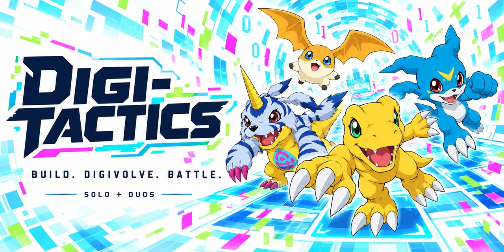

# Digi-Tactics

**Build your team. Digivolve your favorites. Battle solo or bring a partner.**

A free, unofficial Digimon autobattler made for fun. Buy Digimon, combine copies to evolve them, build trait synergies, equip items and position your team before automatic battles.

**Digi-Tactics 2.0.2 is the current native Windows build.** The native edition uses [BRUTAL](https://github.com/ahwootech/BRUTAL) for its Windows desktop foundation, with C# gameplay and native graphics, audio and UI. No Electron or browser runs inside the native game. Existing Electron 1.x releases and their download instructions remain separate below.

**[Release downloads](https://github.com/Wrhinkle/digitactics/releases)** | [Watch the trailer](media/digi-tactics-trailer.mp4) | [Full credits](CREDITS.md) | [Report a bug](https://github.com/Wrhinkle/digitactics/issues)

## Start the native edition

Use the full **[DigiTactics-native-2.0.2-win-x64.zip](https://github.com/Wrhinkle/digitactics/releases/download/native-v2.0.2/DigiTactics-native-2.0.2-win-x64.zip)** (or the matching newer version on the release page). GitHub's automatic **Source code** archives and the `native-update` ZIP are not full installations.

1. Extract the entire ZIP to a local folder. Keep **`DigiTactics.Launcher.exe`**, its accompanying files and the **`app`** and **`launcher`** folders together. Start **`DigiTactics.Launcher.exe`** after extraction.
2. To bring over an existing save, follow the import steps below **before starting a match or changing settings**.
3. For online play, start the Steam desktop client and sign in before opening the game. Solo works without Steam.
4. On Home, choose your **set**, **pace** and **Solo / Duos** format, then Play. Multiplayer opens the Steam lobby controls.

The native package targets **64-bit Windows with an OpenGL 4.5 capable graphics driver**. It includes its .NET runtime; players do not need development tools, a GitHub account or a GitHub token. Use `SHA256SUMS.txt` to check downloaded assets. The trailer was captured from the earlier edition and is not a native performance benchmark.

## What's in the native edition

- **Eleven sets and Chaos:** 22 concrete Normal / Hyper Roll variants, including Undermons, Knockout and Auto Chess. Chaos chooses from the eligible sets using the match seed; Steam hosts can also choose Chaos pace. All peers receive the same resolved choices.
- **Solo and Duos:** AI fills empty seats. Duos has four teams of two, shared health, partner transfers and combined battlefields. Steam rooms include public/friends-only discovery, invites, chat, spectator controls and host recovery.
- **The complete match loop:** shop and economy, positioning, items, traits, augments and set-specific choices, carousels, loot, combat, standings and results. Once you own a three-star unit, that line disappears from your own shop offers while the maxed unit remains on your roster; other players' shops are unaffected.
- **Native presentation:** animated models, boards, attack effects, evolution announcements, elimination cinematics and victory dances, with the Codex and collection previews available in the client.
- **Local progression:** Tamer profile, match history, missions, Bits, cosmetic collections, Daybreak/Cipher rewards, eggs and incubator, companion evolution, Digi-Farm care and training. Digi-Data is companion XP; Bits are spending currency. There are no real-money purchases.
- **Client controls:** saved set/pace/format choices, keyboard help, interface and audio preferences, custom music, save export/reset and explicit import. Home includes set information, patch notes, events and rotating offers drawn from the bundled content.

During a match, press **Esc** or use **Menu** for controls. Solo has an explicit **Pause** option; opening a menu alone does not pause. Online matches cannot be paused. Closing the results panel or returning Home keeps the finished match and any connected room available; use **Leave** to disconnect.

## Bring your save from Electron 1.x

1. In the old game, open **Settings → Export save backup**. Keep the exported JSON and close the old game.
2. On the native app's first Home screen, choose **Import save backup...**, select that JSON and review the displayed profile summary.
3. Choose **Import profile** to apply it. Progress, collection, history, settings and included music files are imported, and the original archive is preserved.

The native app does not automatically read or modify the old Electron profile. Its save folder is **`%LOCALAPPDATA%\DigiTactics\native`**, separate from **`%APPDATA%\Digi-Tactics`**. Existing native saves are never silently merged or replaced. To intentionally replace one, export a native backup in **Settings**, use **Reset save...** with its typed confirmation, then import from Home before making further changes. Keep backups private. Steam identity does not provide Steam Cloud progress sync.

**The first move to native requires the full native ZIP.** Electron's updater cannot install the new native runtime. Later native updates are handled by `DigiTactics.Launcher.exe`: compatible downloads are verified and staged, then applied on restart. A new launcher requirement prompts a full download. GitHub outages do not prevent playing the installed game.

## Online play and limits

Start the game on both PCs with Steam signed in, then create or join a lobby. Everyone should use the same native release. The native edition uses multiplayer protocol **9**; do not assume compatibility with an older Electron build just because both use Steam.

**The integration uses the Spacewar development App ID, 480.** Steam may show Spacewar, and an invite accepted while Digi-Tactics is closed may open the sample application. Keep Digi-Tactics running before accepting an invite. This is an experimental fan-project setup, not an official Steam store release.

Matches are hosted by a player, with validated actions and relayed peer transport. A modified host/client can still cheat. There is no central ranked service, VAC integration or claim of tested large-scale concurrency. Automated tests cover source parity, local multiplayer orchestration and both supported UI sizes. Packaged-app checks cover graphics, audio, dependency closure and staged startup updates. Real two-account Steam reconnect and host migration remain unverified.

**[Online, privacy, saves and updates explained](docs/ONLINE_AND_UPDATES.md)**

## Existing Electron downloads

The historical Windows 1.x package is **`DigiTactics-Steam-<version>.zip`**; extract it and run **`Digi-Tactics.exe`**. `DigiTactics-Steam.exe` is its alternate self-extracting package. Those instructions, `%APPDATA%\Digi-Tactics` saves and the `latest.json` updater apply to Electron only. Keep an old installation available long enough to export your save. The two editions do not share live progress or update payloads.

## Help and development

- **Cannot start native:** check the OpenGL requirement and extract the whole package. Startup errors are recorded in `%LOCALAPPDATA%\DigiTactics\logs\game-error.log` or `launcher-error.log`.
- **No lobbies / cannot connect:** confirm Steam is signed in, restart Digi-Tactics, check both players' versions and room visibility. Solo remains available when online services are unavailable.
- **Update trouble:** close the game, extract the newest full native package and launch it through `DigiTactics.Launcher.exe`. Keep the separate save folder. The installed version is shown in **Settings → About**.
- **Bug reports:** include the version, set, pace, Solo/Duos and online/offline status, reproduction steps and a screenshot in an [issue](https://github.com/Wrhinkle/digitactics/issues). Redact personal paths and account identifiers from logs. Historical Electron logs are in `%APPDATA%\Digi-Tactics\main.log`.
- **Build or run source:** see [the development guide](docs/DEVELOPMENT.md), [native build instructions](native/README.md) and [native artifact assembly](native/tools/NATIVE_RELEASE_ARTIFACTS.md). Browser/Electron source is retained as the original implementation and reference.
- **Security reports:** see [SECURITY.md](SECURITY.md).

## Made for fun, with thanks

**This is a free, non-commercial fan project. No profit is intended or sought.** It is made for people to enjoy, with no official affiliation or endorsement. The original characters, games, models, textures, animations, trademarks and other third-party work belong to their respective creators and rights holders. Free distribution and attribution do not grant rights in those works.

Read **[CREDITS.md](CREDITS.md)** for the original games, companies, mechanics, art, music, tools and contributors; **[the complete model credits](docs/credits/MODELS.md)** for every bundled model and its source; and **[third-party notices](THIRD_PARTY_NOTICES.txt)** for software acknowledgements and licenses. The native package also includes BRUTAL notices and `app/media/MEDIA_RUNTIME_NOTICES.txt`; its matching FFmpeg source/build archive accompanies native release artifacts. Original artists and community extractors/uploaders are credited separately where known. Missing names are marked explicitly. Attribution corrections or removal requests are welcome through [the issue tracker](https://github.com/Wrhinkle/digitactics/issues).

This repository is shared as source-available. It does not claim a blanket open-source license over the game or its third-party assets. Keep the attribution and applicable notices with downstream work.
